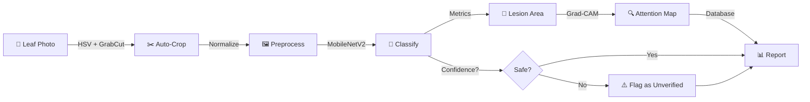

<div align="center">

# 🌿 PlantVision AI

### **From Plant Images to Agricultural Intelligence**

**An Intelligent Plant Health Analysis Platform Powered by Deep Learning**

[العربية](#-نظرة-عامة-ar) • [English](#-overview-en) • [GitHub](https://github.com/pophassan525/PlantVision-AI) • [Demo](#-quick-start)

---

[](https://www.python.org/)
[](https://pytorch.org/)
[](https://streamlit.io/)
[](docs/ROADMAP.md)
[](#-roadmap)
[](LICENSE)

</div>

---

## 📊 At a Glance

| Metric | Value |
|:------:|:-----:|
| **Plant Classes** | 38 |
| **Crops Supported** | 14 |
| **Test Accuracy** | 94.1% |
| **Inference Time** | ~200ms |
| **Dataset Size** | 54,284 images |
| **Processing** | GPU (NVIDIA GTX 1650+) |

---

## ✨ What Makes PlantVision AI Special?

<table>
<tr>
<td width="50%">

### 🎯 **Smart & Safe**
- ✅ **Confidence Guards** block uncertain predictions
- ✅ **Quality Checks** flag blurry/poorly-framed photos
- ✅ **Knows Its Limits** — won't guess on out-of-scope plants
- ✅ **Per-class Thresholds** — easier classes require less confidence

</td>
<td width="50%">

### ⚡ **Fast & Efficient**
- 🚀 **MobileNetV2** — lightweight, optimized for real devices
- 💨 **<200ms inference** on consumer GPU
- 📱 **Responsive design** — desktop to mobile
- 🌐 **Bilingual UI** — English + العربية (RTL)

</td>
</tr>
<tr>
<td width="50%">

### 📊 **Detailed Analysis**
- 🔍 **Auto-crop** leaf region with GrabCut
- 📐 **Lesion analysis** — pixel-level affected tissue %
- 🗺️ **Grad-CAM maps** — see where the model looked
- 📈 **Health trends** — track changes over time

</td>
<td width="50%">

### 📦 **Production-Ready**
- 🗄️ **SQLite history** — all scans logged & searchable
- 📄 **PDF reports** — shareable health analysis
- 🔄 **Batch scanning** — process multiple leaves
- 📚 **Knowledge base** — searchable treatment advice

</td>
</tr>
</table>

---

## 🔬 How It Works

```
📸 UPLOAD LEAF → 🤖 ANALYZE → 📊 REPORT
```

**The Pipeline:**



**In Plain English:**
1. Upload a photo of a single leaf
2. System auto-crops the leaf and normalizes lighting
3. MobileNetV2 deep learning model identifies the plant & disease
4. Lesion detector measures affected tissue area (pixel analysis, not guessing)
5. Grad-CAM shows you exactly where the model focused
6. Confidence guards decide: is this prediction trustworthy?
7. Generate a detailed report with care advice

---

## 🎯 Key Features

### 🌾 **Plant Identification**
- **38 disease classes** across 14 crops
- **94.1% test accuracy** on held-out test set
- **99.7% top-5 accuracy** — your plant is almost always in the top 5
- Supports: Apple, Blueberry, Cherry, Corn, Grape, Orange, Peach, Pepper, Potato, Raspberry, Soybean, Squash, Strawberry, Tomato

### 🔐 **Safety Features**
| Feature | Purpose |
|---------|---------|
| **Entropy Gate** | Blocks predictions when model is uncertain (entropy > 0.40) |
| **Margin Guard** | Flags when top predictions are too close (margin < 0.12) |
| **Per-Class Thresholds** | Hard classes need 86% confidence; easy ones need 70% |
| **Quality Metrics** | Warns if photo is blurry, too small, or poorly framed |
| **Manual Review Option** | Show "unverified" predictions in expandable section |

### 📸 **Image Processing**
- **Smart auto-crop** — HSV + GrabCut for perfect leaf isolation
- **Histogram normalization** (CLAHE) — handles uneven lighting
- **Sharpness detection** — warns on blurry photos
- **Lesion measurement** — real pixel-level analysis (not ML guess)
- **Size checking** — ensures leaf fills at least 15% of frame

### 📊 **Reports & Export**
| Format | Use Case |
|--------|----------|
| **HTML Report** | Self-contained, print to PDF, share digitally |
| **CSV Batch** | Analyze 10+ leaves, get summary statistics |
| **Health Timeline** | Track the same plant over weeks/months |
| **Database Search** | Query all past scans by crop, disease, date |

### 🎨 **UI/UX**
- 🌓 **Dark theme** with green accents (plant-inspired)
- 🎯 **Bilingual** — seamless English ↔ العربية switching
- 📱 **Responsive** — desktop, tablet, phone
- ⚡ **Real-time updates** — results refresh as you adjust settings
- 🎭 **Aurora animations** — smooth, professional interactions

---

## 📈 Model Performance

**Evaluation on Test Set (n = 1,245 images, never seen during training)**

```
┌─────────────────────────────────────────┐
│            ACCURACY: 94.1%              │
│                                         │
│     Top-1: 94.1% | Top-5: 99.7%       │
│     F1 (macro): 91.2% | F1 (weighted): 94.1% │
└─────────────────────────────────────────┘
```

**Per-Class Performance:**
- 🏆 **Best:** Potato healthy (F1: 99%), Corn healthy (F1: 98%)
- 📊 **Average:** 91.2% (macro F1)
- ⚠️ **Challenging:** Tomato late blight (F1: 72%), Grape black rot (F1: 77%)

**Why some classes are harder?** Real-world variation — late blight can look like other fungal diseases; requires more training data to distinguish.

---

## 🚀 Quick Start

### **Installation (5 minutes)**

```bash
# 1. Clone repository
git clone https://github.com/pophassan525/PlantVision-AI.git
cd PlantVision-AI

# 2. Create virtual environment
python -m venv venv

# 3. Activate environment
# Windows:
venv\Scripts\activate
# Linux/Mac:
source venv/bin/activate

# 4. Install dependencies
pip install -r requirements.txt

# 5. Configure
cp .env.example .env

# 6. Run app
streamlit run app.py
```

**That's it!** Open `http://localhost:8501` in your browser.

---

## 📖 How to Use

### **🟢 Single Leaf Analysis (Most Common)**

1. Click **"Upload a leaf photo"**
   - Best: plain background, natural light, leaf fills frame
2. Click **"Analyze"** button
3. View results:
   - ✅ Plant ID + Disease (if any)
   - 📊 Confidence meter
   - 📐 Lesion % (affected tissue area)
   - 🔍 Model attention map (where it looked)
   - ⚠️ Any reliability warnings
   - 💡 Top 5 alternative predictions

### **🟡 Batch Scanning (Multiple Leaves)**

1. Upload 2+ images
2. Click **"Analyse all images"**
3. Get:
   - Summary statistics
   - Per-image table (sortable)
   - CSV download for your records

### **🔵 Browse History**

- See all your past scans
- Filter by crop, disease, date
- Track plant health trends
- Export as CSV

### **🟣 Knowledge Base**

- Search by symptom (e.g., "brown spots")
- Search by disease (e.g., "late blight")
- View full descriptions & treatment advice

---

## 💻 Technology Stack

### **Core**
| Component | Technology | Why? |
|-----------|-----------|------|
| **Deep Learning** | PyTorch + MobileNetV2 | Fast, accurate, mobile-friendly |
| **Image Processing** | OpenCV 4.8+ | Best-in-class CV pipeline |
| **Web Framework** | Streamlit 1.28+ | Interactive, bilingual, no backend needed |
| **Data Processing** | Pandas + NumPy | Efficient array operations |
| **Storage** | SQLite | No server required, local persistence |

### **Visualization**
| Component | Technology | Why? |
|-----------|-----------|------|
| **Charts** | Plotly | Interactive, beautiful, responsive |
| **Maps** | Grad-CAM (PyTorch) | Shows model attention |
| **UI** | Custom CSS in Streamlit | Professional look & feel |

### **Planned (Phase 5+)**
- 🎯 **YOLO v8** — Pest detection (bounding boxes)
- 🤖 **LangChain** — RAG knowledge assistant
- 🗄️ **PostgreSQL** — Cloud-scale history
- 📱 **Mobile app** — iOS/Android native

---

## 📁 Project Structure

```
PlantVision-AI/
│
├── 📄 app.py                           ← Main Streamlit application
├── 📄 requirements.txt                 ← Dependencies
├── 📄 .env.example                     ← Configuration template
│
├── 📂 models/
│   └── plant_classifier/
│       └── best_model.pt               ← Trained MobileNetV2 weights
│
├── 📂 data/
│   ├── train/                          ← 37,982 training images
│   ├── validation/                     ← 8,126 validation images
│   ├── test/                           ← 8,176 test images
│   └── plantvision_history.db          ← Scan history (auto-created)
│
├── 📂 reports/
│   ├── plant_classifier_metrics.json   ← Performance stats
│   ├── plant_classifier_confusion_matrix.png
│   └── training_log.csv
│
├── 📂 scripts/
│   ├── train_plant_classifier.py       ← Training pipeline
│   ├── evaluate.py                     ← Test metrics
│   └── split_dataset.py                ← Data splitting
│
├── 📂 src/
│   └── classification/
│       └── plant_classifier.py         ← Model architecture
│
└── 📂 docs/
    ├── ROADMAP.md                      ← Development phases
    ├── ARCHITECTURE.md                 ← System design
    ├── LIMITATIONS.md                  ← Honest capabilities
    └── DATASET_PLAN.md                 ← Data overview
```

---

## ⚠️ Limitations & Safety

### ✅ **What It Can Do**
- ✓ Identify 38 plant disease classes from single leaf photos
- ✓ Measure lesion area (infected tissue %)
- ✓ Provide treatment advice from knowledge base
- ✓ Flag low-confidence predictions
- ✓ Work offline (no internet required)
- ✓ Process batch scans (10+ images at once)

### ❌ **What It Cannot Do**
- ✗ Diagnose from whole plant photos (only single leaves)
- ✗ Identify plants outside the 38 supported classes
- ✗ Work on heavily edited or filtered photos
- ✗ Diagnose soil deficiencies or pest infestations (Phase 5 for pests)
- ✗ **Replace professional agricultural diagnosis**
- ✗ Work on photos with multiple overlapping leaves

### 🚨 **Why Predictions Can Fail**
| Failure Mode | What to Do |
|-------------|-----------|
| **Blurry photo** | Retake with better focus; app will warn you |
| **Wrong plant** | Only 38 crops supported; check the Top 5 candidates |
| **Multiple leaves** | Auto-crop might pick the wrong one; disable it |
| **Poor lighting** | Use natural daylight; avoid shadows & flash |
| **Disease too early** | Symptoms might not be visible yet; try again in 3-5 days |
| **Leaf too small** | Leaf should fill at least 15% of frame |

**The app proactively warns about all of these.** If unsure, it tells you.

---

## 📊 Roadmap

| Phase | Feature | Status | ETA |
|-------|---------|--------|-----|
| **0** | Scaffold + config | ✅ Done | Sept 2026 |
| **1** | Dataset pipeline | ✅ Done | Sept 2026 |
| **2** | Plant classifier + UI | ✅ Done | Sept 2026 |
| **3** | Confidence guards | ✅ Done | Sept 2026 |
| **4** | Batch + history | ✅ Done | Sept 2026 |
| **5** | YOLO pest detection | 📋 Next | Nov 2026 |
| **6** | Severity estimation | 📋 Planned | Dec 2026 |
| **7** | Knowledge base | 📋 Planned | Jan 2027 |
| **8** | RAG chatbot | 📋 Planned | Feb 2027 |
| **9** | Mobile app | 📋 Future | Q2 2027 |

See [`docs/ROADMAP.md`](docs/ROADMAP.md) for detailed descriptions.

---

## 💡 Pro Tips

### **📸 Best Photo Practices**
1. ☀️ **Natural daylight** — avoid flash and shadows
2. 📐 **Plain background** — white paper, cloth, or solid color
3. 🎯 **Center the leaf** — fill at least 15% of frame
4. 📏 **Hold steady** — use tripod for sharpness
5. ⬆️ **Top-down angle** — camera parallel to leaf

### **🤔 If Prediction Fails**
1. Check the **⚠️ warnings** at the top (blurry? too small?)
2. Look at **Top 5 candidates** — one might be correct
3. Try **Consensus voting** (slower but more reliable)
4. Check **Grad-CAM map** — is it looking at the right leaf part?
5. Retake photo following the tips above

### **🔬 For Advanced Users**
- Export **CSV batch** for analysis in Excel/Python
- Query **SQLite database** (`data/plantvision_history.db`) directly
- Adjust **confidence threshold** in settings
- Disable **auto-crop** for unusually-shaped leaves

---

## 🔗 Links

| Resource | Link |
|----------|------|
| **GitHub** | [pophassan525/PlantVision-AI](https://github.com/pophassan525/PlantVision-AI) |
| **Dataset** | [PlantVillage](https://plantvillage.psu.edu) |
| **Paper** | [Deep Learning for Leaf Diseases](docs/REFERENCES.md) |
| **Issues** | [GitHub Issues](https://github.com/pophassan525/PlantVision-AI/issues) |

---

## 🤝 Contributing

We welcome contributions! Areas we need help with:

- 🐛 **Bug reports** — found something broken?
- 📚 **Documentation** — help improve clarity
- 🌍 **Localization** — translate to more languages
- 🔬 **Pest dataset** — help curate Phase 5 data
- 🧪 **Unit tests** — improve test coverage
- 📱 **Mobile optimization** — make it faster on phones

**How to contribute:**
1. Fork the repository
2. Create a feature branch (`git checkout -b feature/amazing-feature`)
3. Commit changes (`git commit -m 'Add amazing feature'`)
4. Push to branch (`git push origin feature/amazing-feature`)
5. Open a Pull Request

---

## 📜 License

This project is licensed under the **MIT License** — see [`LICENSE`](LICENSE) for details.

### You're free to:
- ✅ Use commercially
- ✅ Modify & distribute
- ✅ Use privately

### You just need to:
- ✓ Include license & copyright notice
- ✓ State changes made

---

## 🙏 Acknowledgments

- **PlantVillage Dataset** — Penn State Image Analytics Lab
- **PyTorch** — Meta AI Research
- **MobileNetV2** — Google Research
- **Streamlit** — Streamlit Inc.
- **OpenCV** — OpenCV team
- **Plotly** — Plotly Technologies

---

## 📧 Support & Feedback

- 💬 **Questions?** Open an [Issue](https://github.com/pophassan525/PlantVision-AI/issues)
- 🐛 **Found a bug?** [Report it](https://github.com/pophassan525/PlantVision-AI/issues/new)
- 💡 **Feature request?** [Suggest it](https://github.com/pophassan525/PlantVision-AI/discussions)
- 📧 **Direct contact:** pophassan525@gmail.com

---

<div align="center">

### Made with 🌱 for farmers, gardeners, students, and plant lovers everywhere.

**Helwan University • Egypt • 2026**

[](https://github.com/pophassan525/PlantVision-AI)
[](https://github.com/pophassan525/PlantVision-AI)

</div>

---

# 📖 نظرة عامة [AR]

## 🎯 مشروع PlantVision AI

**نظام ذكاء اصطناعي متطور لتحليل صحة النباتات والكشف عن الأمراض باستخدام صور الأوراق.**

### ✨ المميزات الرئيسية

**🌾 تصنيف النباتات:**
- 38 فئة مرض عبر 14 محصول زراعي
- دقة اختبار 94.1% على بيانات لم تُرَ من قبل
- دعم: التفاح، الكرز، الذرة، العنب، الطماطم، البطاطس، وأكثر

**🔐 حماية ذكية:**
- رفع توقع إذا كان الموديل غير متأكد
- التحقق من جودة الصورة (ضبابية، حجم صغير)
- عتبات ثقة لكل فئة حسب صعوبتها

**📸 معالجة صور متقدمة:**
- قطع الورقة تلقائياً باستخدام GrabCut
- قياس منطقة الإصابة بالبكسل
- تطبيع الإضاءة (CLAHE)
- خرائط Grad-CAM (إظهار اهتمام الموديل)

**📊 التقارير والتصدير:**
- تقارير HTML قابلة للطباعة
- مسح دفعات (تحليل 10+ أوراق)
- قاعدة بيانات السجل (SQLite)
- تتبع صحة النبات عبر الوقت

### 🚀 البدء السريع

```bash
git clone https://github.com/pophassan525/PlantVision-AI.git
cd PlantVision-AI
pip install -r requirements.txt
streamlit run app.py
```

### 📖 كيفية الاستخدام

1. **رفع صورة ورقة** — خلفية بسيطة، إضاءة طبيعية
2. **انقر تحليل** — سيحدد المرض والشدة
3. **اعرض النتائج** — الهوية + الثقة + نصائح الرعاية
4. **صدّر التقرير** — PDF أو CSV للسجل

### ⚠️ الحدود والتحذيرات

**يمكنه:**
- ✓ تحديد 38 فئة مرض من صور ورقة واحدة
- ✓ قياس نسبة الإصابة
- ✓ توفير نصائح العلاج
- ✓ تحذير التنبؤات غير الموثوقة

**لا يمكنه:**
- ✗ تحديد نباتات خارج الـ 38 المدعومة
- ✗ العمل على صور النبات بالكامل
- ✗ تشخيص نقص العناصر الغذائية
- ✗ استبدال التشخيص الزراعي المحترف

---

<div align="center">

**تم إنشاؤه بـ 🌱 للمزارعين والبستانيين والطلاب وعشاق النبات في كل مكان.**

**جامعة حلوان • مصر • 2026**

</div>
